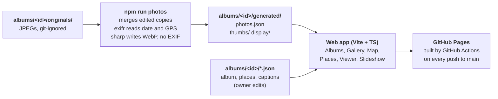

# Photo Albums — Software Requirements Specification

Last updated: 2026-11-20

## 1. Introduction

Photo Albums is a personal, static website that shows trip photos with where and when each was taken, read automatically from the photos' embedded metadata. One repository holds many albums. The first album is **Chennai, November 2026**.

- **Purpose:** browse each trip's photos, see them on a map, and read context about each place visited.
- **Scope:** JPEG photos placed in an album's `originals/` folder. Video, in-browser editing and uploads are out of scope.
- **Audience:** the owner (author of this spec) and the developer (Claude) who builds from it.
- **Hosting:** GitHub Pages, at https://mike-eovino.github.io/photo-albums/ (repository `photo-albums`).
- **Definitions:** *EXIF* = metadata stored inside each JPEG (date, camera, GPS). *Album* = one trip, one folder under `albums/`. *Place* = a named location that groups nearby photos. *MP.jpg* = a Pixel Motion Photo (a JPEG with a short embedded video). *Local language* = the main language where the album was taken (Tamil for Chennai).

## 2. Album: Chennai, November 2026

All 67 photos have GPS coordinates and a capture time. They were taken on a Pixel 10 Pro Fold over 4 days, 15–18 Nov 2026 (IST, UTC+05:30). 10 are Motion Photos. The originals total about 280 MB, and the web copies about 28 MB.

I matched place names to the coordinates from my own knowledge of the area, and wrote the captions after looking at each photo. Both are in the album folder for the owner to check and edit.

| Date | Time (IST) | Place | Tamil name | Photos |
| --- | --- | --- | --- | --- |
| Sun 15 Nov | 07:56 | Chennai International Airport | சென்னை பன்னாட்டு வானூர்தி நிலையம் | 1 |
| Sun 15 Nov | 18:43–18:44 | Kapaleeshwarar Temple, Mylapore | கபாலீசுவரர் கோயில் | 2 |
| Sun 15 Nov | 19:04 | Mylapore streets | மயிலாப்பூர் தெருக்கள் | 2 |
| Mon 16 Nov | 21:21 | Navalur (banana-leaf dinner) | நாவலூர் | 1 |
| Tue 17 Nov | 18:13–18:34 | Guindy (rooftop dinner) | கிண்டி | 3 |
| Wed 18 Nov | 10:31–11:01 | Mahabalipuram: Pancha Rathas | பஞ்ச ரதங்கள் | 22 |
| Wed 18 Nov | 11:05–11:28 | Mahabalipuram: Arjuna's Penance and Krishna's Butter Ball | அர்ஜுனன் தபசு மற்றும் கிருஷ்ணனின் வெண்ணெய் உருண்டை | 23 |
| Wed 18 Nov | 11:41–12:04 | Mahabalipuram: Shore Temple | கடற்கரைக் கோயில் | 8 |
| Wed 18 Nov | 12:11 | Mahabalipuram beach | மாமல்லபுரம் கடற்கரை | 1 |
| Wed 18 Nov | 14:57–15:28 | San Thome Basilica, Santhome | சாந்தோம் பேராலயம் | 4 |

The owner will confirm the Navalur and Guindy stops after viewing the deployed site.

## 3. Overall description

The site is static. A build script turns each album's originals into web images and metadata, and a single-page app renders every album from those files. No server or database is needed.

- **Users:** the owner, plus anyone the owner shares the link with. No logins.
- **Operating environment:** current Chrome, Safari, Firefox and Edge on desktop and phone.
- **Constraints:** originals are 2–7 MB each, so the build creates resized copies. Map tiles come from OpenStreetMap, so maps need an internet connection. GitHub Pages limits a site to 1 GB, which allows roughly 30 albums of this size.
- **Assumptions:** photo EXIF data is accurate. Place names, descriptions and captions are written once by hand (Claude drafts, the owner edits) and stored as JSON in the album folder.

## 4. Functional requirements

Priority **Must** and **Should** are in v1. **Could** is deferred.

| ID | Requirement | Priority |
| --- | --- | --- |
| FR-1 | The build reads EXIF from every JPEG in an album's `originals/`: capture time and UTC offset, GPS latitude, longitude and altitude, camera model, orientation and dimensions.  The build also uses the date to determine if a significant event was happening at that place at that time (FR-23). | Must |
| FR-2 | The app assigns each photo to the nearest place in the album's `places.json`, within that place's radius. Photos with no match go to an "Other" group. Because this happens in the browser, editing `places.json` needs no rebuild of the photos. | Must |
| FR-3 | The build creates a thumbnail (400 px) and a display image (1600 px) in WebP for each photo, with orientation corrected. | Must |
| FR-4 | The web copies contain no EXIF, GPS, XMP or other metadata. | Must |
| FR-5 | **Gallery view:** a grid of thumbnails, grouped by day and then by place. Each group heading shows the place name in English and the local language, the time range and the photo count. | Must |
| FR-6 | **Photo viewer:** a full-screen lightbox with previous and next controls, keyboard arrows and Esc, and swipe on touch devices. | Must |
| FR-7 | **Photo info panel:** the viewer shows the caption, the place name in English and the local language, the place description, the date and time, coordinates with links to Google Maps and OpenStreetMap, altitude, camera, file name, and a small locator map. | Must |
| FR-8 | **Map view:** an interactive map with one marker per place, sized by photo count. Clicking a marker shows its thumbnails, and clicking a thumbnail opens the viewer. | Must |
| FR-9 | **Route line:** the map draws the trip path in time order, colored by day, with a legend. | Should |
| FR-10 | **Places view:** one card per place, with a cover photo, names in English and the local language, a 2–4 sentence description, the visit date and the photo count. | Must |
| FR-11 | **Album header:** the title in English and the local language, a one-line summary, the dates, and counts of photos, places and days, plus the distance travelled between stops. | Should |
| FR-12 | **Filters:** filter the gallery by day and by place. Filter state is kept in the URL so links can be shared. | Should |
| FR-13 | **Deep links:** each album, view and photo has its own URL, for example `#/chennai-2026/photo/PXL_20261118_053619579`. | Should |
| FR-14 | **Captions:** each album has a `captions.json` with one caption per photo, drafted by Claude for the owner to edit. The build lists photos that have no caption yet. | Must |
| FR-15 | **Motion Photos:** `.MP.jpg` files show a badge. Playing the embedded video clip is deferred. | Should (badge) / Could (playback) |
| FR-16 | **Nearby places:** the viewer lists other places within 2 km. | Could |
| FR-17 | Re-running the build after adding, removing or changing photos updates the album, including removing images of deleted photos. It ends with a summary line of photos added, updated, removed and unchanged. See *Change detection* in section 6. | Must |
| FR-18 | **Slideshow:** plays the currently filtered photos, advancing every 4 seconds, with play and pause in the viewer and a progress bar. | Must |
| FR-19 | **Album list:** the home page shows one card per album with its cover photo, titles, dates and counts. | Must |
| FR-20 | **Adding an album:** create `albums/<id>/` with `album.json`, `places.json`, `captions.json` and an `originals/` folder, then run `npm run photos`. No code changes are needed. | Must |
| FR-21 | **Edited copies:** Google Photos saves an edited photo as a new file, such as `X~2.jpg`, with no EXIF. When the build finds one next to its original (`X.jpg` or `X.MP.jpg`), it copies the original's EXIF (date, time zone, GPS, camera) into the copy, deletes the original, and renames the copy to `X.jpg`. The photo keeps its id, caption and links. An edited Motion Photo becomes a still photo. If a photo has more than one edited copy, the build stops without changing anything and asks the owner to keep one. | Must |
| FR-22 | **Tidying:** after each build, places with no photos are removed from `places.json`, and captions of photos that no longer exist are removed from `captions.json`. Remaining entries keep their formatting. The build warns if `coverPhotoId` no longer exists. | Must |
| FR-23 | **Significant events:** for each *visit* (a place on one local date), the build asks Claude (Opus 5.5, through the Anthropic API, with web search, at most 5 searches per visit) whether anything significant was happening there at that time: festivals, ceremonies, public holidays, notable public events at the place, or weather and news affecting it. Each event has an English name, a local-language name, a one- or two-sentence description, start and end dates, a source link and a confidence. Results go into `events.json`, which the owner can edit. A visit that already has an entry is never looked up again, and entries for visits that no longer exist are removed. The app shows events in the viewer's info panel ("Happening here"), on the place's card ("During your visit"), and as a ★ marker on the gallery group heading. | Must |

## 5. Non-functional requirements

| ID | Area | Requirement |
| --- | --- | --- |
| NFR-1 | Performance | The gallery's first view loads in under 2 s on broadband. Thumbnails lazy-load. |
| NFR-2 | Performance | Building a 75-photo album takes under 2 minutes on a laptop. Unchanged photos are skipped on re-runs. |
| NFR-3 | Privacy | No location blurring. If a photo's location should be private, the owner removes that photo from `originals/` and re-runs the build. |
| NFR-4 | Responsiveness | The layout works from 360 px phones to 1920 px desktops. On phones, the info panel sits below the photo. |
| NFR-5 | Accessibility | Every image has alt text (the caption, or the place and time). The viewer works by keyboard alone and keeps focus inside it. Tamil and other local text is marked with its `lang`. |
| NFR-6 | Theming | Light and dark themes follow the system setting. |
| NFR-7 | Maintainability | TypeScript throughout. Album content is plain JSON that can be edited without touching code. |
| NFR-8 | Integrity | Original photos are never uploaded. The build changes `originals/` only to merge an edited copy into its original (FR-21), which deletes the original. It deletes the original only after confirming the copy carries its location. The owner keeps full copies in Google Photos. |
| NFR-9 | Privacy | `albums/*/originals/` is excluded from git. Only the EXIF-free WebP copies and JSON are committed and published. The event lookup (FR-23) sends the Anthropic API only what the site already publishes about a place: its name, area, coordinates, description and the visit's date and time. No photos are sent. |
| NFR-10 | Freshness | GitHub Pages lets browsers cache files for 10 minutes. Changes must still show up as soon as a deploy finishes. Each image URL ends in `?v=<version>`, which changes whenever the photo's WebP copies are rebuilt from different input, so an edited photo gets a new URL even though its file name stays the same. The app fetches the JSON files with `cache: 'no-cache'`, so it always checks for newer data. An unchanged file costs only a quick "not modified" reply. |

## 6. Data and architecture



The photo build runs on the owner's machine, because only it has the originals. GitHub Actions builds the app from the committed `generated/` and JSON files.

**Tech stack:** `exifr` (reading EXIF), `exiftool-vendored` (copying EXIF into edited copies), `@anthropic-ai/sdk` (event lookup), `sharp` (resizing and WebP), Vite 6 + TypeScript with no framework, Leaflet 1.9 + OpenStreetMap tiles, plain CSS with custom properties, Node 22.18 or newer.

**Album files**

| File | Contents | Edited by |
| --- | --- | --- |
| `album.json` | `title`, `titleLocal`, `summary`, `localLanguage` (`code`, `name`), `timeZoneLabel`, `coverPhotoId`, `sortOrder` | Owner |
| `places.json` | per place: `id`, `name`, `nameLocal`, `area`, `lat`, `lon`, `radiusM`, `description` | Owner. The build removes places with no photos (FR-22). |
| `captions.json` | photo id → caption | Owner. The build removes captions of deleted photos (FR-22). |
| `events.json` | visit key (`<placeId>@<YYYY-MM-DD>`) → `place`, `date`, `checked`, and a list of `events` (`name`, `nameLocal`, `description`, `startDate`, `endDate`, `sourceUrl`, `confidence`) | Build drafts new visits (FR-23); owner edits |
| `generated/photos.json` | per photo: `id`, `file`, `takenAt`, `lat`, `lon`, `alt`, `width`, `height`, `camera`, `motion`, `thumb`, `display`, `v` (image version for cache busting, NFR-10) | Build only |
| `generated/build-manifest.json` | the image settings used, and per photo: `file` and a SHA-256 of the original. Committed but not published. | Build only |

**The photo build (`npm run photos`)**

The owner runs `npm run photos` after adding, removing or editing photos in an album's `originals/`. It runs from the repository root or from `app/`. With no argument it builds every album that has an `originals/` folder on this machine. `npm run photos -- <album-id>` builds one album. Albums without an `originals/` folder are skipped, and their committed `generated/` files are left as they are.

For each album, it works through these steps in order:

1. **Merge edited copies (FR-21).** It looks for files named like `X~2.jpg` or `X.MP~2.jpg`. If any photo has more than one edited copy, it stops before changing anything. For each edited copy, it copies the original's EXIF (date, time zone, GPS, camera) into the copy with exiftool. It resets the orientation to upright, because the edited pixels already are, and leaves out the original's embedded thumbnail. It checks that the copy now has the original's location. Only then does it delete the original and rename the copy to `X.jpg`. An edited copy with no original is just renamed.
2. **Read each photo.** For every `.jpg` or `.jpeg` in `originals/`, four at a time, it reads:
   - the SHA-256 of the file
   - the capture time and its UTC offset
   - the GPS latitude and longitude, and the altitude rounded to 0.1 m
   - the camera model
   - the width and height after applying the orientation

   A photo's id is its file name without `.MP` and `.jpg`. A file name with `.MP` marks a Motion Photo.
3. **Write web images (FR-3, FR-4).** It writes two WebP copies at quality 80: `thumbs/` (400 px) and `display/` (1600 px). The size is the longest side, and photos are never enlarged. Copies are rotated upright and contain no EXIF, GPS or XMP. A photo is skipped when its SHA-256 and the image settings match `build-manifest.json` and both copies exist (see *Change detection*).
4. **Remove stale images (FR-17).** It deletes any `.webp` in `thumbs/` or `display/` that has no matching original.
5. **Write `generated/photos.json` and `generated/build-manifest.json`.** Photos are listed in capture-time order. Each photo's `v` is a short hash of its original's SHA-256 and the image settings, so it changes exactly when the WebP copies are rebuilt from different input (NFR-10). Both files are rewritten from scratch on every run.
6. **Tidy the album files (FR-22).** It removes places with no photos from `places.json`, using the same nearest-place rule as the app (FR-2). It removes captions of photos that no longer exist from `captions.json`. It skips the place check if no photo has GPS data, because every place would then look empty.
7. **Look up significant events (FR-23).** It groups photos into visits: each place on each local date, skipping photos in "Other". For each visit with no entry in `events.json`, it sends Claude the place's name, area, coordinates and description, the local date and time of the photos, and the album's local language. Claude searches the web (at most 5 searches) and reports any events through a strict JSON tool, so the result is always well-formed. If a safety check declines a request, the API retries it on a suitable model (`fallbacks: "default"`). It removes entries for visits that no longer exist. The API key is read from the macOS Keychain (service `photo-albums-anthropic`). With no key, or if a lookup fails, it skips that visit with a note and tries again on the next run.
8. **Report.** It prints a summary line, then a line for each of these that applies:
   - each edited copy it merged
   - places and captions it removed
   - a `coverPhotoId` that no longer exists
   - photos with no caption yet
   - photos with no GPS data
   - each event lookup, with the events found, and the number of searches and estimated cost

   For example:

   ```
   chennai-2026: 0 added, 1 updated, 0 removed, 68 unchanged (69 photos, 1.1 s)
     merged PXL_20261115_131355309~2.jpg into PXL_20261115_131355309.jpg: copied the date, location and camera from PXL_20261115_131355309.jpg, then deleted PXL_20261115_131355309.jpg
   ```

Event lookups are billed to the owner's prepaid Anthropic API credits: about 25–30¢ per new visit. The key is limited to a `photo-albums` workspace with its own monthly spending limit, and auto-reload is off, so spending can't exceed the credit bought.

The build stops with an error, and exits with status 1, when an album's `originals/` has no JPEGs, when a photo has more than one edited copy, or when copying metadata into an edited copy fails. In the last case the original is kept. Setting `DEBUG=1` prints the full stack trace.

The build does not commit, push or deploy. The owner reviews the changes, then commits and pushes `generated/` and the JSON files. GitHub Actions never runs the photo build, because the originals are not in the repository.

**Change detection**

`npm run photos` compares each album's `originals/` with what it built last time, and reports the result in the summary line.

| Change | Detected? | How |
| --- | --- | --- |
| **Added** | Yes | A new original has no WebP copies yet, so both sizes are created. |
| **Removed** | Yes | Any `.webp` with no matching original is deleted. `photos.json` is rewritten from scratch every run, so the photo drops out. |
| **Changed** | Yes | The WebP copies are rebuilt when the original's SHA-256 differs from the one in `build-manifest.json`. File timestamps are not used, so an edited original with an older date (for example from `cp -p` or a Google Takeout export) is still caught. |
| **Image settings changed** | Yes | The manifest records the sizes, WebP quality and a pipeline version. If any of them change, every photo is rebuilt. |
| **WebP copy deleted by hand** | Yes | A missing copy is recreated. |
| **EXIF edited** | Yes | EXIF is re-read from every original on every run, so `photos.json` is always current even when the images are skipped. |
| **Edited copy added** (`X~2.jpg`) | Yes | It is merged into its original first (FR-21), then counted as an update to `X`. |
| **Place left with no photos** | Yes | The place is removed from `places.json`, and the captions of deleted photos are removed from `captions.json` (FR-22). |
| **New visit** (a place on a new date) | Yes | It has no entry in `events.json`, so its events are looked up (FR-23). Existing entries are never looked up again; delete an entry to look it up again. |

Hashing the originals takes well under a second per album, so an unchanged re-run is fast (NFR-2). Two originals that differ only by `.MP` (for example `X.jpg` and `X.MP.jpg`) would share a photo id. This does not happen with Pixel file names, so it is not handled.

**Project layout**

```
photo-albums/
  SRS.md
  package.json                   runs the app/ npm commands from the root
  .github/workflows/deploy.yml   builds and publishes to GitHub Pages
  albums/
    chennai-2026/
      album.json  places.json  captions.json
      originals/                 git-ignored
      generated/                 committed
  app/
    scripts/build-photos.ts      npm run photos [album-id]
    scripts/events.ts            event lookup with Claude and web search (FR-23)
    src/                         main.ts, data.ts, places.ts, viewer.ts, map.ts, styles.css
    vite.config.ts               serves and copies albums/*, never originals/ or build-manifest.json
```

## 7. Decisions

Answers from the owner, 20 Nov 2026.

| Question | Decision |
| --- | --- |
| Are the place names right? | To be checked by the owner on the deployed site. |
| Should any place be blurred? | No. Private photos will be removed instead. |
| Repository layout | One `photo-albums` repository with a folder per album, served at `mike-eovino.github.io/photo-albums/`. |
| Languages | Place names and album titles in English and the local language. |
| Captions | Claude drafts captions now, and the owner edits them. |
| Could items in v1 | FR-18 slideshow (now Must). FR-16 and Motion Photo playback stay deferred. |
| Removed photos (20–21 Nov) | The second airport photo, the five OMR photos and two photos at Arjuna's Penance. The OMR place is removed. |
| Edited copies from Google Photos | The build merges each one into its original and deletes the original (FR-21). The owner keeps full copies in Google Photos. |
| Places with no photos | Removed from `places.json` automatically (FR-22). |
| Finding significant events | Done by the build, not the app, using Claude through the Anthropic API with web search (FR-23). Billed to prepaid credits with auto-reload off, in a `photo-albums` workspace with a monthly spending limit. The key is kept in the macOS Keychain, never in the repository or the shell environment. |
| Trip title | "Chennai, November 2026". |
