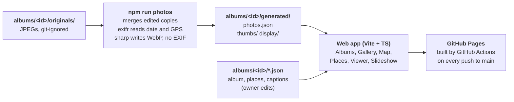

# Photo Albums — Software Requirements Specification

Last updated: 2026-11-20

## 1. Introduction

Photo Albums is a personal, static website that shows trip photos with where and when each was taken, read automatically from the photos' embedded metadata. One repository holds many albums: **Chennai, November 2026** and **Scotland, June 2024**.

- **Purpose:** browse each trip's photos, see them on a map, and read context about each place visited.
- **Scope:** JPEG photos and MP4 or MOV videos placed in an album's `originals/` folder. In-browser editing and uploads are out of scope.
- **Audience:** the owner (author of this spec) and the developer (Claude) who builds from it.
- **Hosting:** GitHub Pages, at https://mike-eovino.github.io/photo-albums/ (repository `photo-albums`).
- **Definitions:** *EXIF* = metadata stored inside each JPEG (date, camera, GPS). *Album* = one trip, one folder under `albums/`. *Place* = a named location that groups nearby photos. *MP.jpg* = a Pixel Motion Photo (a JPEG with a short embedded video). *Local language* = the main language where the album was taken (Tamil for Chennai). Optional: Scotland has none. *Video* = an MP4 or MOV file in `originals/`; the app treats it as an item in the album like a photo.

## 2. Albums

### Chennai, November 2026

All 64 photos have GPS coordinates and a capture time. They were taken on a Pixel 10 Pro Fold over 4 days, 15–18 Nov 2026 (IST, UTC+05:30). 10 are Motion Photos. The originals total about 260 MB, and the web copies about 25 MB.

I matched place names to the coordinates from my own knowledge of the area, and wrote the captions after looking at each photo. Both are in the album folder for the owner to check and edit.

| Date | Time (IST) | Place | Tamil name | Photos |
| --- | --- | --- | --- | --- |
| Sun 15 Nov | 07:56 | Chennai International Airport | சென்னை பன்னாட்டு வானூர்தி நிலையம் | 1 |
| Sun 15 Nov | 18:43–18:44 | Kapaleeshwarar Temple, Mylapore | கபாலீசுவரர் கோயில் | 2 |
| Sun 15 Nov | 19:04 | Mylapore streets | மயிலாப்பூர் தெருக்கள் | 2 |
| Mon 16 Nov | 21:21 | Navalur (team dinner at Fazari Restaurant) | நாவலூர் | 1 |
| Tue 17 Nov | 18:13–18:34 | Guindy (team dinner on the Ramada Plaza rooftop) | கிண்டி | 3 |
| Wed 18 Nov | 10:31–11:01 | Mahabalipuram: Pancha Rathas | பஞ்ச ரதங்கள் | 20 |
| Wed 18 Nov | 11:05–11:28 | Mahabalipuram: Arjuna's Penance and Krishna's Butter Ball | அர்ஜுனன் தபசு மற்றும் கிருஷ்ணனின் வெண்ணெய் உருண்டை | 22 |
| Wed 18 Nov | 11:41–12:04 | Mahabalipuram: Shore Temple | கடற்கரைக் கோயில் | 8 |
| Wed 18 Nov | 12:11 | Mahabalipuram beach | மாமல்லபுரம் கடற்கரை | 1 |
| Wed 18 Nov | 14:57–15:28 | San Thome Basilica, Santhome | சாந்தோம் பேராலயம் | 4 |

The owner confirmed the Navalur and Guindy stops on 21 Nov 2026: team dinners at Fazari Restaurant and on the Ramada Plaza by Wyndham Chennai rooftop. Both are recorded as events in `events.json`.

### Scotland, June 2024

181 photos and 6 videos, taken on a Pixel 7 over 11 days, 24 Jun – 4 Jul 2024 (BST, UTC+01:00). The trip runs from Heathrow to Edinburgh Airport, through the Howe of Fife to St Andrews, then golf at Fairmont St Andrews, the Castle Course, Kingsbarns, Dumbarnie and the Eden Course, and two days in Edinburgh. The originals total about 1.8 GB, and the web copies about 150 MB, of which 89 MB is video.

Claude drafted 18 places and all captions from the coordinates and the photos (21 Nov 2026), for the owner to check. The owner removed 36 photos on 21 Nov 2026. Three Kingsbarns photos were taken without a GPS fix (the phone recorded only the compass direction), and four photos' GPS jumped kilometres away in the middle of a round of golf. All seven get their position from a neighbouring photo through `overrides.json` (FR-25). `IMG_20251103_165547.jpg`, the Swilcan Bridge photo, has no EXIF at all. The owner placed it on the walking tour of St Andrews on 27 Jun, so `overrides.json` gives it the bridge's coordinates and the time of a photo taken 35 m from the bridge (10:45), and it appears under The Old Course. Events were not looked up: the trip was mostly golf and travel, so on 21 Nov 2026 the owner chose to add events by hand instead. Every visit is marked as checked in `events.json`, and the one event is Rita's first eagle at Kingsbarns on 28 Jun. Hole numbers in the golf captions (76 photos, 21 Nov 2026) come from matching each photo's position to the hole layouts in OpenStreetMap, keeping the holes in playing order. They are given only where the match is confident: the Torrance at Fairmont, the Castle Course, Kingsbarns, Dumbarnie and the first 13 holes of the Eden Course. The Old Course photos were taken on walks, and its shared double greens make position alone unreliable, so they have none. The album has no local language.

## 3. Overall description

The site is static. A build script turns each album's originals into web images and metadata, and a single-page app renders every album from those files. No server or database is needed.

- **Users:** the owner, plus anyone the owner shares the link with. No logins.
- **Operating environment:** current Chrome, Safari, Firefox and Edge on desktop and phone.
- **Constraints:** originals are 2–7 MB each, so the build creates resized copies. Map tiles come from OpenStreetMap, so maps need an internet connection. GitHub Pages limits a site to 1 GB, which allows roughly 30 albums of this size.
- **Assumptions:** photo EXIF data is accurate. Place names, descriptions and captions are written once by hand (Claude drafts, the owner edits) and stored as JSON in the album folder.

## 4. Functional requirements

Priority **Must** and **Should** are in v1. **Could** is deferred.

| ID | Requirement | Priority |
| --- | --- | --- |
| FR-1 | The build reads EXIF from every JPEG in an album's `originals/`: capture time and UTC offset, GPS latitude, longitude and altitude, camera model, orientation and dimensions.  The build also uses the date to determine if a significant event was happening at that place at that time (FR-23). | Must |
| FR-2 | The app assigns each photo to the nearest place in the album's `places.json`, within that place's radius. Photos with no match go to an "Other" group. Because this happens in the browser, editing `places.json` needs no rebuild of the photos. | Must |
| FR-3 | The build creates a thumbnail (400 px) and a display image (1600 px) in WebP for each photo, with orientation corrected. | Must |
| FR-4 | The web copies contain no EXIF, GPS, XMP or other metadata. | Must |
| FR-5 | **Gallery view:** a grid of thumbnails, grouped by day and then by place. Each group heading shows the place name in English and the local language, the time range and the photo count. Photos with no capture date (no EXIF) are listed last, under "Unknown date", and don't affect the album's date range or day count. The viewer leaves out the "Taken" line for them. | Must |
| FR-6 | **Photo viewer:** a full-screen lightbox with previous and next controls, keyboard arrows and Esc, and swipe on touch devices. | Must |
| FR-7 | **Photo info panel:** the viewer shows the caption, the place name in English and the local language, the place description, the date and time, coordinates with links to Google Maps and OpenStreetMap, altitude, camera, file name, and a small locator map. | Must |
| FR-8 | **Map view:** an interactive map with one marker per place, sized by photo count. Clicking a marker shows its thumbnails, and clicking a thumbnail opens the viewer. | Must |
| FR-9 | **Route line:** the map draws the trip path in time order, colored by day, with a legend. | Should |
| FR-10 | **Places view:** one card per place, with a cover photo, names in English and the local language, a 2–4 sentence description, the visit date and the photo count. | Must |
| FR-11 | **Album header:** the title in English and the local language, a one-line summary, the dates, and counts of photos, places and days, plus the distance travelled between stops. | Should |
| FR-12 | **Filters:** filter the gallery by day and by place. Filter state is kept in the URL so links can be shared. | Should |
| FR-13 | **Deep links:** each album, view and photo has its own URL, for example `#/chennai-2026/photo/PXL_20261118_053619579`. | Should |
| FR-14 | **Captions:** each album has a `captions.json` with one caption per photo, drafted by Claude for the owner to edit. The build lists photos that have no caption yet. | Must |
| FR-15 | **Motion Photos:** `.MP.jpg` files show a badge. Playing the embedded video clip is deferred (21 Nov 2026). | Should (badge) / Could (playback) |
| FR-16 | **Nearby places:** the viewer lists other places within 2 km. | Could |
| FR-17 | Re-running the build after adding, removing or changing photos updates the album, including removing images of deleted photos. It ends with a summary line of photos added, updated, removed and unchanged. See *Change detection* in section 6. | Must |
| FR-18 | **Slideshow:** plays the currently filtered photos, advancing every 4 seconds, with play and pause in the viewer and a progress bar. A video plays to its end before the slideshow moves on (FR-24). | Must |
| FR-19 | **Album list:** the home page shows one card per album with its cover photo, titles, dates and counts. | Must |
| FR-20 | **Adding an album:** create `albums/<id>/` with `album.json`, `places.json`, `captions.json` and an `originals/` folder, then run `npm run photos`. No code changes are needed. | Must |
| FR-21 | **Edited copies:** Google Photos saves an edited photo as a new file, such as `X~2.jpg`, with no EXIF. When the build finds one next to its original (`X.jpg` or `X.MP.jpg`), it copies the original's EXIF (date, time zone, GPS, camera) into the copy, deletes the original, and renames the copy to `X.jpg`. The photo keeps its id, caption and links. An edited Motion Photo becomes a still photo. If a photo has more than one edited copy, the build stops without changing anything and asks the owner to keep one. | Must |
| FR-22 | **Tidying:** after each build, places with no photos are removed from `places.json`, and captions of photos that no longer exist are removed from `captions.json`. Remaining entries keep their formatting. The build warns if `coverPhotoId` no longer exists. | Must |
| FR-23 | **Significant events:** for each *visit* (a place on one local date), the build asks Claude (Opus 5.5, through the Anthropic API, with web search, at most 5 searches per visit) whether anything significant was happening there at that time: festivals, ceremonies, public holidays, notable public events at the place, or weather and news affecting it. Location is strict: the build sends the average location of the visit's photos, and the event's venue must be within the place's radius of it (at least 300 m, plus the spread of the photos). Phone GPS is accurate to about 5–20 m outdoors, so this separates an event at the place from one elsewhere in the same district. The event must also be something a person standing there could have seen or taken part in; conferences, campus events and private functions at another venue don't count. Each occasion is reported once. Each event has an English name, a local-language name, its venue, a one- or two-sentence description, start and end dates, a source link and a confidence. Results go into `events.json`, which the owner can edit. A visit that already has an entry is never looked up again, and entries for visits that no longer exist are removed. The app shows events in the viewer's info panel ("Happening here"), on the place's card ("During your visit"), and as a ★ marker on the gallery group heading. Lookups cost money, so they run only when the owner asks: `npm run photos -- <album-id> --events`. Without `--events`, the build reports how many visits are waiting and the estimated cost. | Must |
| FR-24 | **Videos:** MP4 and MOV files in `originals/` are part of the album. The build converts each one to a web copy: H.264 and AAC in MP4, the short side scaled to at most 1080 px, 30 frames a second, with no metadata (no date, GPS or camera). A frame from about 1 s in becomes its thumbnail and display image. The video's date, location and length come from its own metadata: Pixel phones record the time a video ends, so the start is that time minus the length, and exiftool works out the local time zone from the GPS position. Videos join places, days and visits like photos. The gallery shows a ▶ badge with the length, the viewer plays the video with standard controls, and the header and home page count photos and videos separately. An edited copy of a video (`X~2.mp4`) replaces its original, because Google Photos keeps the date and location in edited videos; the build stops if the edited copy has no date or location. | Must |
| FR-25 | **Overrides:** `overrides.json` in the album folder sets a photo's position or capture time by hand. Per photo, `location` is either the id of another photo whose GPS position is copied, or `{ "lat": …, "lon": … }`; `takenAt` is either the id of another photo whose capture time is copied, or a time with its UTC offset, such as `"2024-06-27T10:45:00+01:00"`. It is for photos taken without a GPS fix, photos whose GPS jumped away, and photos with no EXIF. The build applies it to `photos.json` and marks the photo `locationSetByHand` or `dateSetByHand`; the viewer shows "(set by hand)" next to the location or time. The originals are not changed. Values are copied from the other photo's own metadata, never from another override. Entries that can't be applied produce a warning, and entries for deleted photos are removed. Changes take effect on the next `npm run photos`. | Must |

## 5. Non-functional requirements

| ID | Area | Requirement |
| --- | --- | --- |
| NFR-1 | Performance | The gallery's first view loads in under 2 s on broadband. Thumbnails lazy-load. |
| NFR-2 | Performance | Building a 75-photo album takes under 2 minutes on a laptop. Unchanged photos are skipped on re-runs. |
| NFR-3 | Privacy | No location blurring. If a photo's location should be private, the owner removes that photo from `originals/` and re-runs the build. |
| NFR-4 | Responsiveness | The layout works from 360 px phones to 1920 px desktops. On phones, the info panel sits below the photo. |
| NFR-5 | Accessibility | Every image has alt text (the caption, or the place and time). The viewer works by keyboard alone and keeps focus inside it. Tamil and other local text is marked with its `lang`. |
| NFR-6 | Theming | Light and dark themes follow the system setting. |
| NFR-7 | Maintainability | TypeScript throughout. Album content is plain JSON that can be edited without touching code. |
| NFR-8 | Integrity | Original photos and videos are never uploaded. The build changes `originals/` only to merge an edited copy into its original (FR-21, FR-24), which deletes the original. It deletes the original only after confirming the copy carries its location. The owner keeps full copies in Google Photos. |
| NFR-9 | Privacy | `albums/*/originals/` is excluded from git. Only the EXIF-free WebP copies, the metadata-free video copies and JSON are committed and published. The build checks each video copy for location data and stops if it finds any. Videos dropped straight into an album folder are git-ignored too. The event lookup (FR-23) sends the Anthropic API only what the site already publishes about a place: its name, area, coordinates, description and the visit's date and time. No photos are sent. |
| NFR-10 | Freshness | GitHub Pages lets browsers cache files for 10 minutes. Changes must still show up as soon as a deploy finishes. Each image URL ends in `?v=<version>`, which changes whenever the photo's WebP copies are rebuilt from different input, so an edited photo gets a new URL even though its file name stays the same. The app fetches the JSON files with `cache: 'no-cache'`, so it always checks for newer data. An unchanged file costs only a quick "not modified" reply. |

## 6. Data and architecture



The photo build runs on the owner's machine, because only it has the originals. GitHub Actions builds the app from the committed `generated/` and JSON files.

**Tech stack:** `exifr` (reading EXIF), `exiftool-vendored` (copying EXIF into edited copies, and reading video metadata), `ffmpeg-static` (a bundled ffmpeg, for video copies and frames), `@anthropic-ai/sdk` (event lookup), `sharp` (resizing and WebP), Vite 6 + TypeScript with no framework, Leaflet 1.9 + OpenStreetMap tiles, plain CSS with custom properties, Node 22.18 or newer.

**Album files**

| File | Contents | Edited by |
| --- | --- | --- |
| `album.json` | `title`, `titleLocal`, `summary`, `localLanguage` (`code`, `name`), `timeZoneLabel`, `coverPhotoId`, `sortOrder` | Owner |
| `places.json` | per place: `id`, `name`, `nameLocal`, `area`, `lat`, `lon`, `radiusM`, `description` | Owner. The build removes places with no photos (FR-22). |
| `captions.json` | photo id → caption | Owner. The build removes captions of deleted photos (FR-22). |
| `overrides.json` | optional: photo id → `location` (another photo's id, or `{ lat, lon }`) and/or `takenAt` (another photo's id, or a time with offset) (FR-25). Used by the build, not published. | Owner. The build removes entries for deleted photos. |
| `events.json` | visit key (`<placeId>@<YYYY-MM-DD>`) → `place`, `date`, `checked`, and a list of `events` (`name`, `nameLocal`, `venue`, `description`, `startDate`, `endDate`, `sourceUrl`, `confidence`) | Build drafts new visits (FR-23); owner edits |
| `generated/photos.json` | per photo or video: `id`, `file`, `takenAt`, `lat`, `lon`, `alt`, `width`, `height`, `camera`, `motion`, `thumb`, `display`, `v` (image version for cache busting, NFR-10); videos also have `video` (the web copy) and `duration` (seconds) | Build only |
| `generated/build-manifest.json` | the image settings and video settings used, and per photo or video: `file` and a SHA-256 of the original. Committed but not published. | Build only |

**The photo build (`npm run photos`)**

The owner runs `npm run photos` after adding, removing or editing photos in an album's `originals/`. It runs from the repository root or from `app/`. With no argument it builds every album that has an `originals/` folder on this machine. `npm run photos -- <album-id>` builds one album. Adding `--events` also looks up events for new visits (step 7), which costs money; any other option is an error. Albums without an `originals/` folder are skipped, and their committed `generated/` files are left as they are.

For each album, it works through these steps in order:

1. **Merge edited copies (FR-21, FR-24).** An edited video (`X~2.mp4`) replaces `X.mp4`, as long as it has a date and location. It looks for files named like `X~2.jpg` or `X.MP~2.jpg`. If any photo has more than one edited copy, it stops before changing anything. For each edited copy, it copies the original's EXIF (date, time zone, GPS, camera) into the copy with exiftool. It resets the orientation to upright, because the edited pixels already are, and leaves out the original's embedded thumbnail. It checks that the copy now has the original's location. Only then does it delete the original and rename the copy to `X.jpg`. An edited copy with no original is just renamed.
2. **Read each photo.** For every `.jpg` or `.jpeg` in `originals/`, four at a time, it reads:
   - the SHA-256 of the file
   - the capture time and its UTC offset
   - the GPS latitude and longitude, and the altitude rounded to 0.1 m
   - the camera model
   - the width and height after applying the orientation

   A photo's id is its file name without `.MP` and `.jpg`. A file name with `.MP` marks a Motion Photo.

   For each `.mp4` or `.mov`, one at a time, it reads the SHA-256, the end time, length, GPS position, camera model, size and rotation with exiftool (FR-24). A video's id is its file name without the extension. A photo and a video with the same id stop the build.
3. **Write web images (FR-3, FR-4).** It writes two WebP copies at quality 80: `thumbs/` (400 px) and `display/` (1600 px). The size is the longest side, and photos are never enlarged. Copies are rotated upright and contain no EXIF, GPS or XMP. A photo is skipped when its SHA-256 and the image settings match `build-manifest.json` and both copies exist (see *Change detection*). For each video it writes a web copy to `videos/` with ffmpeg (FR-24), first under a temporary name so an interrupted run leaves no half-written copy. Then it takes a frame for the two WebP copies. Converting 4K video takes about as long as the video plays (Scotland's six clips took about 2½ minutes), and is skipped when the video's SHA-256 and the video settings are unchanged. A web copy over 95 MB stops the build, because GitHub refuses files over 100 MB.
4. **Remove stale images (FR-17).** It deletes any `.webp` in `thumbs/` or `display/`, and any `.mp4` in `videos/`, that has no matching original.
5. **Write `generated/photos.json` and `generated/build-manifest.json`.** First it applies `overrides.json` (FR-25). Photos are listed in capture-time order, with photos that have no capture date last. Each photo's `v` is a short hash of its original's SHA-256 and the image settings, so it changes exactly when the WebP copies are rebuilt from different input (NFR-10). Both files are rewritten from scratch on every run.
6. **Tidy the album files (FR-22).** It removes places with no photos from `places.json`, using the same nearest-place rule as the app (FR-2). It removes captions of photos that no longer exist from `captions.json`. It skips the place check if no photo has GPS data, because every place would then look empty.
7. **Look up significant events (FR-23), only with `--events`.** Without it, the build lists how many visits have no entry yet. It groups photos into visits: each place on each local date, skipping photos in "Other". For each visit with no entry in `events.json`, it sends Claude the place's name, area, coordinates and description, the local date and time of the photos, and the album's local language. Claude searches the web (at most 5 searches) and reports any events through a strict JSON tool, so the result is always well-formed. If a safety check declines a request, the API retries it on a suitable model (`fallbacks: "default"`). It removes entries for visits that no longer exist. The API key is read from the macOS Keychain (service `photo-albums-anthropic`). With no key, or if a lookup fails, it skips that visit with a note and tries again on the next run.
8. **Report.** It prints a summary line, then a line for each of these that applies:
   - each edited copy it merged
   - each video it converted, with its length
   - places and captions it removed
   - a `coverPhotoId` that no longer exists
   - photos with no caption yet
   - photos with no capture date
   - the number of locations and capture times set from `overrides.json`, and entries that couldn't be applied
   - photos with no GPS data
   - each event lookup, with the events found, and the number of searches and estimated cost
   - without `--events`: the number of visits waiting for a lookup, the estimated cost, and the command to run it

   For example:

   ```
   chennai-2026: 0 added, 1 updated, 0 removed, 68 unchanged (69 photos, 1.1 s)
     merged PXL_20261115_131355309~2.jpg into PXL_20261115_131355309.jpg: copied the date, location and camera from PXL_20261115_131355309.jpg, then deleted PXL_20261115_131355309.jpg
   ```

Event lookups are billed to the owner's prepaid Anthropic API credits: about 25–30¢ per new visit. The key is limited to a `photo-albums` workspace with its own monthly spending limit, and auto-reload is off, so spending can't exceed the credit bought.

The build stops with an error, and exits with status 1, when an album's `originals/` has no photos or videos, when a photo or video has more than one edited copy, when copying metadata into an edited copy fails (the original is kept), when an edited video has no date or location (the original is kept), when a photo and a video share an id, when a video's web copy still contains a location or is over 95 MB (the copy is deleted), or when an option other than `--events` is given. Setting `DEBUG=1` prints the full stack trace.

The build does not commit, push or deploy. The owner reviews the changes, then commits and pushes `generated/` and the JSON files. GitHub Actions never runs the photo build, because the originals are not in the repository.

**Change detection**

`npm run photos` compares each album's `originals/` with what it built last time, and reports the result in the summary line.

| Change | Detected? | How |
| --- | --- | --- |
| **Added** | Yes | A new original has no WebP copies yet, so both sizes are created. |
| **Removed** | Yes | Any `.webp` with no matching original is deleted. `photos.json` is rewritten from scratch every run, so the photo drops out. |
| **Changed** | Yes | The WebP copies are rebuilt when the original's SHA-256 differs from the one in `build-manifest.json`. File timestamps are not used, so an edited original with an older date (for example from `cp -p` or a Google Takeout export) is still caught. |
| **Image settings changed** | Yes | The manifest records the sizes, WebP quality and a pipeline version. If any of them change, every photo is rebuilt. |
| **WebP copy deleted by hand** | Yes | A missing copy is recreated. |
| **EXIF edited** | Yes | EXIF is re-read from every original on every run, so `photos.json` is always current even when the images are skipped. |
| **Edited copy added** (`X~2.jpg`) | Yes | It is merged into its original first (FR-21), then counted as an update to `X`. |
| **Place left with no photos** | Yes | The place is removed from `places.json`, and the captions of deleted photos are removed from `captions.json` (FR-22). |
| **Video added, changed or removed** | Yes | The same as for photos, using the video's SHA-256. The manifest records the video settings separately, so changing them rebuilds only the videos. |
| **`overrides.json` edited** | Yes | It is read on every run. Only `photos.json` changes; no images are rebuilt. |
| **New visit** (a place on a new date) | Yes | It has no entry in `events.json`. With `--events` its events are looked up (FR-23); without it the build reports it as waiting. Existing entries are never looked up again; delete an entry to look it up again. |

Hashing the originals takes well under a second per album, so an unchanged re-run is fast (NFR-2). Two originals that differ only by `.MP` (for example `X.jpg` and `X.MP.jpg`) would share a photo id. This does not happen with Pixel file names, so it is not handled.

**Project layout**

```
photo-albums/
  SRS.md
  package.json                   runs the app/ npm commands from the root
  .github/workflows/deploy.yml   builds and publishes to GitHub Pages
  albums/
    chennai-2026/  scotland-2024/
      album.json  places.json  captions.json  events.json  overrides.json
      originals/                 git-ignored
      generated/                 committed: photos.json, thumbs/, display/, videos/
  app/
    scripts/build-photos.ts      npm run photos [album-id] [--events]
    scripts/events.ts            event lookup with Claude and web search (FR-23)
    src/                         main.ts, data.ts, places.ts, viewer.ts, map.ts, styles.css
    vite.config.ts               serves and copies albums/*, never originals/ or build-manifest.json
```

## 7. Decisions

Answers from the owner, 20 Nov 2026.

| Question | Decision |
| --- | --- |
| Are the place names right? | Yes. The owner checked them on the deployed site; Navalur and Guindy were confirmed on 21 Nov. |
| Should any place be blurred? | No. Private photos will be removed instead. |
| Repository layout | One `photo-albums` repository with a folder per album, served at `mike-eovino.github.io/photo-albums/`. |
| Languages | Place names and album titles in English and the local language. |
| Captions | Claude drafts captions now, and the owner edits them. |
| Could items in v1 | FR-18 slideshow (now Must). FR-16 and Motion Photo playback stay deferred. |
| Videos (21 Nov) | Added (FR-24), at 1080p and 30 fps. The 4K originals are 63 Mbps and up to 750 MB, far over GitHub's 100 MB limit; the 1080p copies are about 5 Mbps. Motion Photo clips stay deferred. |
| Photos without a GPS position or date (21 Nov) | Set by hand in `overrides.json` (FR-25), usually by copying a neighbouring photo's position or time, rather than writing metadata into the originals. |
| When to look up events (21 Nov) | Only when asked, with `--events`, so the owner can remove photos and check places first. For Scotland the owner chose not to look up events at all and to add them by hand. |
| Removed photos (20–21 Nov) | The second airport photo, the five OMR photos, two photos at Pancha Rathas and three at Arjuna's Penance. The OMR place is removed. |
| Edited copies from Google Photos | The build merges each one into its original and deletes the original (FR-21). The owner keeps full copies in Google Photos. |
| Places with no photos | Removed from `places.json` automatically (FR-22). |
| Event location (21 Nov) | The first lookup linked the Guindy dinner to a conference at IIT Madras, about 2 km away. The lookup now requires the venue to be within the place's radius of the photos and to be something a passer-by could see. That event is removed. |
| Finding significant events | Done by the build, not the app, using Claude through the Anthropic API with web search (FR-23). Billed to prepaid credits with auto-reload off, in a `photo-albums` workspace with a monthly spending limit. The key is kept in the macOS Keychain, never in the repository or the shell environment. |
| Trip title | "Chennai, November 2026". |
