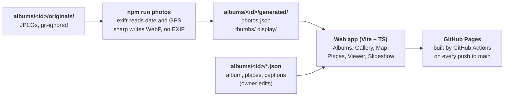

# Photo Albums — Software Requirements Specification

Last updated: 2026-11-20

## 1. Introduction

Photo Albums is a personal, static website that shows trip photos with where and when each was taken, read automatically from the photos' embedded metadata. One repository holds many albums. The first album is **Chennai, November 2026**.

- **Purpose:** browse each trip's photos, see them on a map, and read context about each place visited.
- **Scope:** JPEG photos placed in an album's `originals/` folder. Video, in-browser editing and uploads are out of scope.
- **Audience:** the owner (author of this spec) and the developer (Claude) who builds from it.
- **Hosting:** GitHub Pages, at https://mike-eovino.github.io/photo-albums/ (repository `photo-albums`).
- **Definitions:** *EXIF* = metadata stored inside each JPEG (date, camera, GPS). *Album* = one trip, one folder under `albums/`. *Place* = a named location that groups nearby photos. *MP.jpg* = a Pixel Motion Photo (a JPEG with a short embedded video). *Local language* = the main language where the album was taken (Tamil for Chennai).

## 2. Album: Chennai, November 2026

All 75 photos have GPS coordinates and a capture time. They were taken on a Pixel 10 Pro Fold over 4 days, 15–18 Nov 2026 (IST, UTC+05:30). 12 are Motion Photos. The originals total about 330 MB, and the web copies about 30 MB.

I matched place names to the coordinates from my own knowledge of the area, and wrote the captions after looking at each photo. Both are in the album folder for the owner to check and edit.

| Date | Time (IST) | Place | Tamil name | Photos |
| --- | --- | --- | --- | --- |
| Sun 15 Nov | 07:56–08:07 | Chennai International Airport | சென்னை பன்னாட்டு வானூர்தி நிலையம் | 2 |
| Sun 15 Nov | 18:43–18:44 | Kapaleeshwarar Temple, Mylapore | கபாலீசுவரர் கோயில் | 2 |
| Sun 15 Nov | 19:04 | Mylapore streets | மயிலாப்பூர் தெருக்கள் | 2 |
| Mon 16 Nov | 09:51–10:59 | OMR IT corridor (Ford + Red Hat event) | பழைய மாமல்லபுரம் சாலை | 5 |
| Mon 16 Nov | 21:21 | Navalur (banana-leaf dinner) | நாவலூர் | 1 |
| Tue 17 Nov | 18:13–18:34 | Guindy (rooftop dinner) | கிண்டி | 3 |
| Wed 18 Nov | 10:31–11:01 | Mahabalipuram: Pancha Rathas | பஞ்ச ரதங்கள் | 22 |
| Wed 18 Nov | 11:05–11:28 | Mahabalipuram: Arjuna's Penance and Krishna's Butter Ball | அர்ஜுனன் தபசு மற்றும் கிருஷ்ணனின் வெண்ணெய் உருண்டை | 25 |
| Wed 18 Nov | 11:41–12:04 | Mahabalipuram: Shore Temple | கடற்கரைக் கோயில் | 8 |
| Wed 18 Nov | 12:11 | Mahabalipuram beach | மாமல்லபுரம் கடற்கரை | 1 |
| Wed 18 Nov | 14:57–15:28 | San Thome Basilica, Santhome | சாந்தோம் பேராலயம் | 4 |

The owner will confirm the OMR, Navalur and Guindy stops after viewing the deployed site.

## 3. Overall description

The site is static. A build script turns each album's originals into web images and metadata, and a single-page app renders every album from those files. No server or database is needed.

- **Users:** the owner, plus anyone the owner shares the link with. No logins.
- **Operating environment:** current Chrome, Safari, Firefox and Edge on desktop and phone.
- **Constraints:** originals are 2–7 MB each, so the build creates resized copies. Map tiles come from OpenStreetMap, so maps need an internet connection. GitHub Pages limits a site to 1 GB, which allows roughly 30 albums of this size.
- **Assumptions:** photo EXIF data is accurate. Place names, descriptions and captions are written once by hand (Claude drafts, the owner edits) and stored as JSON in the album folder.

## 4. Functional requirements

Priority **Must** and **Should** are in v1. **Could** is deferred.

| ID | Requirement | Priority |
| --- | --- | --- |
| FR-1 | The build reads EXIF from every JPEG in an album's `originals/`: capture time and UTC offset, GPS latitude, longitude and altitude, camera model, orientation and dimensions. | Must |
| FR-2 | The app assigns each photo to the nearest place in the album's `places.json`, within that place's radius. Photos with no match go to an "Other" group. Because this happens in the browser, editing `places.json` needs no rebuild of the photos. | Must |
| FR-3 | The build creates a thumbnail (400 px) and a display image (1600 px) in WebP for each photo, with orientation corrected. | Must |
| FR-4 | The web copies contain no EXIF, GPS, XMP or other metadata. | Must |
| FR-5 | **Gallery view:** a grid of thumbnails, grouped by day and then by place. Each group heading shows the place name in English and the local language, the time range and the photo count. | Must |
| FR-6 | **Photo viewer:** a full-screen lightbox with previous and next controls, keyboard arrows and Esc, and swipe on touch devices. | Must |
| FR-7 | **Photo info panel:** the viewer shows the caption, the place name in English and the local language, the place description, the date and time, coordinates with links to Google Maps and OpenStreetMap, altitude, camera, file name, and a small locator map. | Must |
| FR-8 | **Map view:** an interactive map with one marker per place, sized by photo count. Clicking a marker shows its thumbnails, and clicking a thumbnail opens the viewer. | Must |
| FR-9 | **Route line:** the map draws the trip path in time order, colored by day, with a legend. | Should |
| FR-10 | **Places view:** one card per place, with a cover photo, names in English and the local language, a 2–4 sentence description, the visit date and the photo count. | Must |
| FR-11 | **Album header:** the title in English and the local language, a one-line summary, the dates, and counts of photos, places and days, plus the distance travelled between stops. | Should |
| FR-12 | **Filters:** filter the gallery by day and by place. Filter state is kept in the URL so links can be shared. | Should |
| FR-13 | **Deep links:** each album, view and photo has its own URL, for example `#/chennai-2026/photo/PXL_20261118_053619579`. | Should |
| FR-14 | **Captions:** each album has a `captions.json` with one caption per photo, drafted by Claude for the owner to edit. | Must |
| FR-15 | **Motion Photos:** `.MP.jpg` files show a badge. Playing the embedded video clip is deferred. | Should (badge) / Could (playback) |
| FR-16 | **Nearby places:** the viewer lists other places within 2 km. | Could |
| FR-17 | Re-running the build after adding or removing photos updates the album, including removing images of deleted photos. | Must |
| FR-18 | **Slideshow:** plays the currently filtered photos, advancing every 4 seconds, with play and pause in the viewer and a progress bar. | Must |
| FR-19 | **Album list:** the home page shows one card per album with its cover photo, titles, dates and counts. | Must |
| FR-20 | **Adding an album:** create `albums/<id>/` with `album.json`, `places.json`, `captions.json` and an `originals/` folder, then run `npm run photos`. No code changes are needed. | Must |

## 5. Non-functional requirements

| ID | Area | Requirement |
| --- | --- | --- |
| NFR-1 | Performance | The gallery's first view loads in under 2 s on broadband. Thumbnails lazy-load. |
| NFR-2 | Performance | Building a 75-photo album takes under 2 minutes on a laptop. Unchanged photos are skipped on re-runs. |
| NFR-3 | Privacy | No location blurring. If a photo's location should be private, the owner removes that photo from `originals/` and re-runs the build. |
| NFR-4 | Responsiveness | The layout works from 360 px phones to 1920 px desktops. On phones, the info panel sits below the photo. |
| NFR-5 | Accessibility | Every image has alt text (the caption, or the place and time). The viewer works by keyboard alone and keeps focus inside it. Tamil and other local text is marked with its `lang`. |
| NFR-6 | Theming | Light and dark themes follow the system setting. |
| NFR-7 | Maintainability | TypeScript throughout. Album content is plain JSON that can be edited without touching code. |
| NFR-8 | Integrity | Original photos are never modified or uploaded. |
| NFR-9 | Privacy | `albums/*/originals/` is excluded from git. Only the EXIF-free WebP copies and JSON are committed and published. |

## 6. Data and architecture



The photo build runs on the owner's machine, because only it has the originals. GitHub Actions builds the app from the committed `generated/` and JSON files.

**Tech stack:** `exifr` (EXIF), `sharp` (resizing and WebP), Vite 6 + TypeScript with no framework, Leaflet 1.9 + OpenStreetMap tiles, plain CSS with custom properties, Node 22.18 or newer.

**Album files**

| File | Contents | Edited by |
| --- | --- | --- |
| `album.json` | `title`, `titleLocal`, `summary`, `localLanguage` (`code`, `name`), `timeZoneLabel`, `coverPhotoId`, `sortOrder` | Owner |
| `places.json` | per place: `id`, `name`, `nameLocal`, `area`, `lat`, `lon`, `radiusM`, `description` | Owner |
| `captions.json` | photo id → caption | Owner |
| `generated/photos.json` | per photo: `id`, `file`, `takenAt`, `lat`, `lon`, `alt`, `width`, `height`, `camera`, `motion`, `thumb`, `display` | Build only |

**Project layout**

```
photo-albums/
  SRS.md
  .github/workflows/deploy.yml   builds and publishes to GitHub Pages
  albums/
    chennai-2026/
      album.json  places.json  captions.json
      originals/                 git-ignored
      generated/                 committed
  app/
    scripts/build-photos.ts      npm run photos [album-id]
    src/                         main.ts, data.ts, viewer.ts, map.ts, styles.css
    vite.config.ts               serves and copies albums/*, never originals/
```

## 7. Decisions

Answers from the owner, 20 Nov 2026.

| Question | Decision |
| --- | --- |
| Are the place names right? | To be checked by the owner on the deployed site. |
| Should any place be blurred? | No. Private photos will be removed instead. |
| Repository layout | One `photo-albums` repository with a folder per album, served at `mike-eovino.github.io/photo-albums/`. |
| Languages | Place names and album titles in English and the local language. |
| Captions | Claude drafts captions now, and the owner edits them. |
| Could items in v1 | FR-18 slideshow (now Must). FR-16 and Motion Photo playback stay deferred. |
| Trip title | "Chennai, November 2026". |
